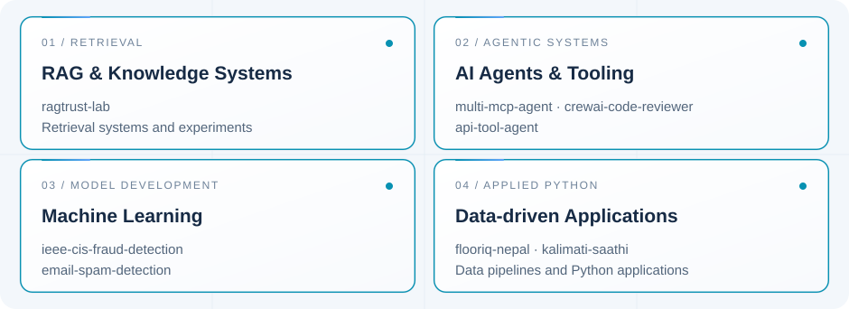

<!--
  GANESH POKHAREL
  AI ENGINEERING PORTFOLIO
-->

<h1>Ganesh Pokharel</h1>

  <strong>AI Engineer</strong>
  &nbsp; | &nbsp;
  Python Developer
  &nbsp; | &nbsp;
  LLM Systems
  &nbsp; | &nbsp;
  Agentic AI

  
  &nbsp;
  
  &nbsp;
  
  &nbsp;
  

---

## About Me

I'm **Ganesh Pokharel**, a Python Developer and AI Engineering practitioner focused on building intelligent applications using Machine Learning, Deep Learning, and Generative AI.

My hands-on work spans LLM-powered applications, advanced retrieval systems, AI agent orchestration, model development, fine-tuning, evaluation, API integration, and application development.

I am particularly interested in connecting machine learning models, language models, retrieval pipelines, and software systems to solve practical problems.

  

---

<h2 align="center">What I Build</h2>

  Engineering intelligent applications across machine learning,
  LLM systems, retrieval architectures, and agentic workflows.

  

---

<h2 align="center">Current Engineering Work</h2>

  Building AI-powered products and intelligent automation
  systems across real-world application domains.

  

  <strong>Recently completed:</strong>
  skillsathi-ai — Bilingual RAG chatbot for SkillShikshya
  with automatic website content synchronization.

  
    Private repositories · 1 development completed · 5 in progress
  

---

<h2 align="center">Technical Labs &amp; Experiments</h2>

  Hands-on implementations exploring retrieval systems,
  AI agents, machine learning, and applied Python development.

  

  <a href="https://github.com/GaneshPokharel-tech/ragtrust-lab">RAGTrust Lab</a>
  &nbsp; · &nbsp;
  <a href="https://github.com/GaneshPokharel-tech/multi-mcp-agent">Multi MCP Agent</a>
  &nbsp; · &nbsp;
  <a href="https://github.com/GaneshPokharel-tech/flooriq-nepal">FloorIQ Nepal</a>

<strong>Explore all technical repositories</strong>

### Retrieval & RAG

- [ragtrust-lab](https://github.com/GaneshPokharel-tech/ragtrust-lab)

### AI Agents & MCP

- [multi-mcp-agent](https://github.com/GaneshPokharel-tech/multi-mcp-agent)
- [crewai-code-reviewer](https://github.com/GaneshPokharel-tech/crewai-code-reviewer)
- [api-tool-agent](https://github.com/GaneshPokharel-tech/api-tool-agent)

### Machine Learning

- [ieee-cis-fraud-detection](https://github.com/GaneshPokharel-tech/ieee-cis-fraud-detection)
- [email-spam-detection](https://github.com/GaneshPokharel-tech/email-spam-detection)

### Applied Data Applications

- [flooriq-nepal](https://github.com/GaneshPokharel-tech/flooriq-nepal)
- [kalimati-saathi](https://github.com/GaneshPokharel-tech/kalimati-saathi)

**[View all repositories](https://github.com/GaneshPokharel-tech?tab=repositories)**

---

## Technologies & Tools

  

<strong>Explore My Complete Technical Stack</strong>

### Programming & Data Science

Python · NumPy · Pandas · Matplotlib · Scikit-learn

### Machine Learning & Deep Learning

ML Algorithms · TensorFlow · PyTorch · Hugging Face · Transformers · Model Fine-tuning

### Generative AI & LLM Engineering

OpenAI API · LangChain · LangGraph · Large Language Models · Generative AI

### Retrieval & Knowledge Systems

RAG · Advanced RAG · Vector Databases · Retrieval Pipelines

### AI Agents & Orchestration

CrewAI · Model Context Protocol (MCP) · Agent Orchestration · Multi-Agent Systems · API Integration

### AI Evaluation

LLM Evaluations · RAG Evaluations · Model Evaluation

### Backend & Deployment

FastAPI · Streamlit · Docker · REST APIs · Git · GitHub

---

AI ENGINEERING · MACHINE LEARNING · INTELLIGENT SYSTEMS

