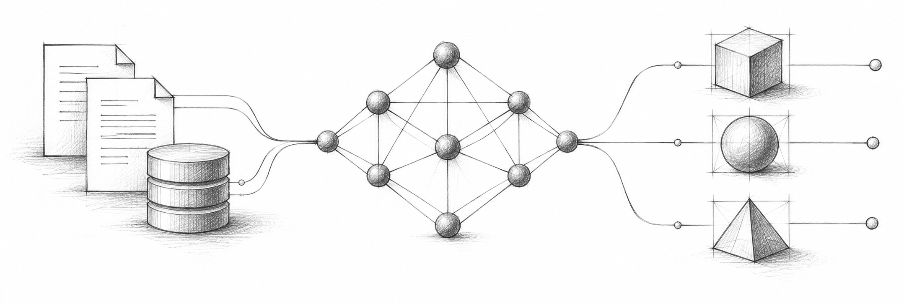
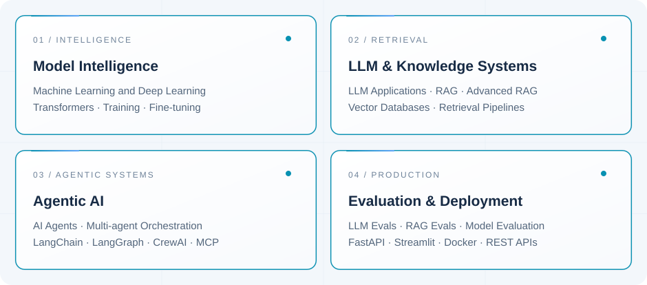
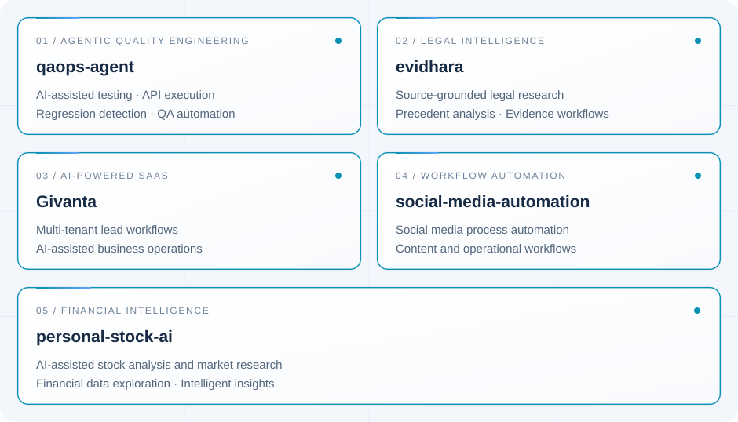

<!--
  GANESH POKHAREL
  AI ENGINEERING PORTFOLIO
-->

<h1>Ganesh Pokharel</h1>

  <strong>AI Engineer</strong>
  &nbsp; | &nbsp;
  Machine Learning
  &nbsp; | &nbsp;
  LLM Systems
  &nbsp; | &nbsp;
  Agentic AI

 

  
  &nbsp;
  
  &nbsp;
  
  &nbsp;
  

---

## About Me

I'm **Ganesh Pokharel**, an AI Engineering practitioner with hands-on experience building Machine Learning, Deep Learning, and Generative AI applications using Python.

I develop LLM-powered applications, advanced retrieval systems, and AI agent workflows. My work covers model development, fine-tuning, evaluation, API integration, and application deployment.

  

---

<h2 align="center">What I Build</h2>

  I design and build intelligent systems across
  machine learning, LLM engineering, agentic AI,
  and production-ready applications.

  

---

<h2 align="center">Current Engineering Work</h2>

  Building AI-powered products and intelligent automation
  systems across multiple real-world domains.

  

  
    Private repositories · Active development
  

---

## Technical Labs & Experiments

Alongside product development, I build technical experiments to strengthen my understanding of machine learning, LLM engineering, retrieval systems, and AI agents.

These repositories document my hands-on implementations and learning process.

**Retrieval & LLM Systems**
- [ragtrust-lab](https://github.com/GaneshPokharel-tech/ragtrust-lab)

**AI Agents & Tool Integration**
- [multi-mcp-agent](https://github.com/GaneshPokharel-tech/multi-mcp-agent)
- [crewai-code-reviewer](https://github.com/GaneshPokharel-tech/crewai-code-reviewer)
- [api-tool-agent](https://github.com/GaneshPokharel-tech/api-tool-agent)

**Machine Learning & Applied Data Science**
- [ieee-cis-fraud-detection](https://github.com/GaneshPokharel-tech/ieee-cis-fraud-detection)
- [email-spam-detection](https://github.com/GaneshPokharel-tech/email-spam-detection)

**Applied Python & Data Applications**
- [flooriq-nepal](https://github.com/GaneshPokharel-tech/flooriq-nepal)
- [kalimati-saathi](https://github.com/GaneshPokharel-tech/kalimati-saathi)

---

## Technologies & Tools

  

<strong>Explore My Complete Technical Stack</strong>

 

**Programming & Data Science**

Python · NumPy · Pandas · Matplotlib · Scikit-learn

**Machine Learning & Deep Learning**

ML Algorithms · TensorFlow · PyTorch · Hugging Face · Transformers · Model Fine-tuning

**Generative AI & LLM Engineering**

OpenAI API · LangChain · LangGraph · Large Language Models · Generative AI

**Retrieval & Knowledge Systems**

RAG · Advanced RAG · Vector Databases · Retrieval Pipelines

**AI Agents & Orchestration**

CrewAI · Model Context Protocol (MCP) · Agent Orchestration · Multi-Agent Systems · API Integration

**AI Evaluation**

LLM Evaluations · RAG Evaluations · Model Evaluation

**Backend & Deployment**

FastAPI · Streamlit · Docker · REST APIs · Git · GitHub

---

## Projects & Implementations

My repositories cover practical implementations and experiments across Machine Learning, Generative AI, retrieval systems, and AI agent development.

**[Explore My GitHub Repositories](https://github.com/GaneshPokharel-tech?tab=repositories)**

---

AI ENGINEERING · MACHINE LEARNING · INTELLIGENT SYSTEMS

