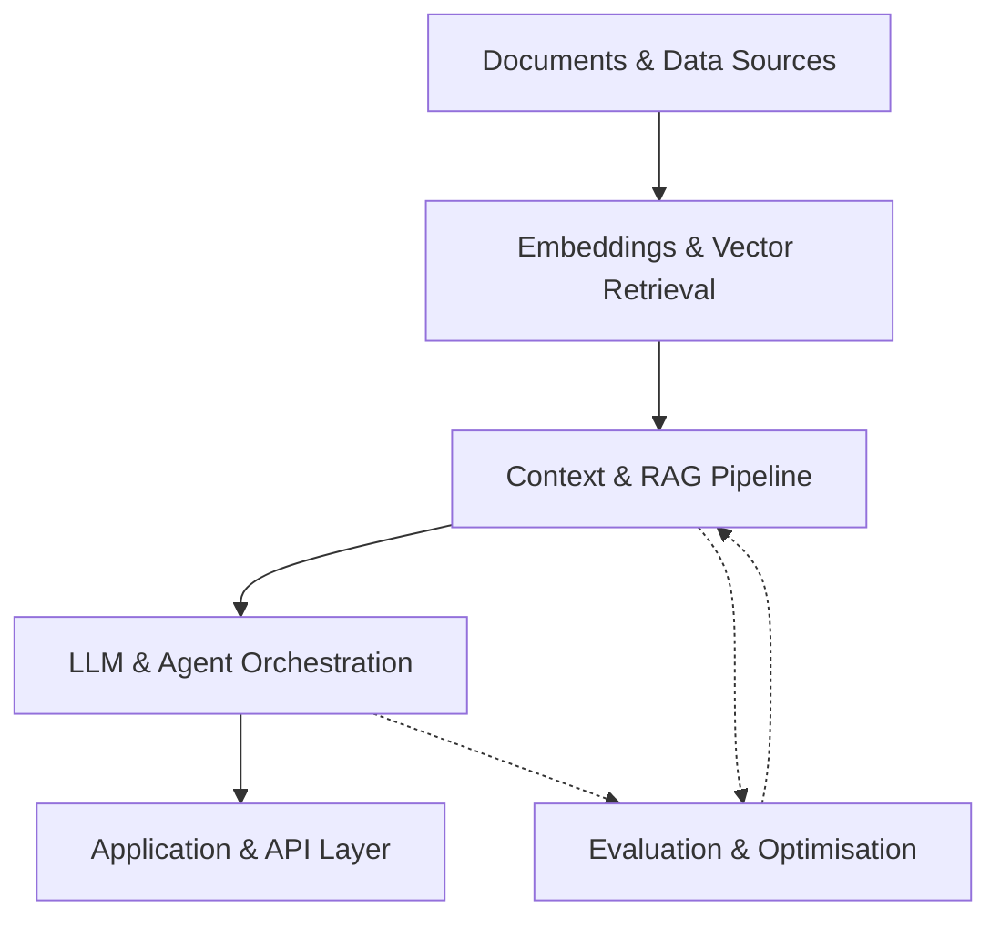

<!--
  GANESH POKHAREL
  AI Engineering Portfolio
-->

  

  

  <a href="https://www.linkedin.com/in/ganesh-pokharel-30786b192/">LinkedIn</a>
  &nbsp; / &nbsp;
  <a href="https://github.com/GaneshPokharel-tech?tab=repositories">Repositories</a>
  &nbsp; / &nbsp;
  <a href="https://www.instagram.com/ganeeshpokharel/">Instagram</a>
  &nbsp; / &nbsp;
  <a href="https://www.facebook.com/ganeeshpokharel/">Facebook</a>

---

## About

I'm **Ganesh Pokharel**, an AI Engineering practitioner focused on developing intelligent applications using Python, Machine Learning, Deep Learning, and Large Language Models.

My hands-on work covers the development of LLM-powered applications, advanced retrieval systems, AI agent orchestration, model fine-tuning, and evaluation workflows.

I work across the AI development lifecycle, from data preparation and model development to API integration, application development, and deployment.

**Primary focus:** AI Engineering, Generative AI, Retrieval-Augmented Generation, and Agentic AI.

---

## Engineering Capabilities

| Domain | Experience |
|:---|:---|
| **Machine Learning** | ML algorithms, model training, deep learning, and fine-tuning |
| **LLM Engineering** | LLM applications, Transformers, Generative AI, and API integrations |
| **Retrieval Systems** | RAG, Advanced RAG, vector databases, and retrieval pipelines |
| **Agentic AI** | AI agents, multi-agent orchestration, LangGraph, CrewAI, and MCP |
| **Evaluation** | LLM evaluations, RAG evaluations, and model performance assessment |
| **Application Development** | Python APIs, FastAPI, Streamlit, and Docker-based deployment |

---

## Technology Stack

### Programming & Data

`Python` · `NumPy` · `Pandas` · `Matplotlib` · `Scikit-learn`

### Machine Learning & Deep Learning

`TensorFlow` · `PyTorch` · `Hugging Face` · `Transformers` · `ML Algorithms` · `Model Fine-tuning`

### LLM & Generative AI Engineering

`OpenAI API` · `LangChain` · `LangGraph` · `Large Language Models` · `Generative AI`

### Retrieval & Knowledge Systems

`RAG` · `Advanced RAG` · `Vector Databases` · `Retrieval Pipelines`

### AI Agents & Orchestration

`CrewAI` · `Model Context Protocol (MCP)` · `Agent Orchestration` · `Multi-Agent Systems`

### Evaluation & Development

`LLM Evals` · `RAG Evals` · `Model Evaluation` · `API Integration` · `REST APIs`

### Backend & Deployment

`FastAPI` · `Streamlit` · `Docker` · `Git` · `GitHub`

---

## AI Systems Architecture

I work with AI architectures that connect data retrieval, language models, agent workflows, and application interfaces.

<b>Explore an example LLM / RAG architecture</b>

 

**Core components**

- **Retrieval:** Document processing, embeddings, and vector search
- **Generation:** LLM inference and context-aware responses
- **Agents:** Tool integration, MCP, LangChain, LangGraph, and CrewAI
- **Evaluation:** Response quality, retrieval relevance, and model behaviour
- **Delivery:** API development and application deployment

---

## GitHub Activity

  
  

---

## Work & Repositories

My repositories cover projects, experiments, and implementations involving Python, Machine Learning, Generative AI, RAG, and AI agent systems.

**[Explore my repositories](https://github.com/GaneshPokharel-tech?tab=repositories)**

---

## Connect

I'm interested in connecting with developers and engineers working on practical AI systems, intelligent applications, and emerging AI technologies.

- **LinkedIn:** [Ganesh Pokharel](https://www.linkedin.com/in/ganesh-pokharel-30786b192/)
- **GitHub:** [GaneshPokharel-tech](https://github.com/GaneshPokharel-tech)
- **Instagram:** [@ganeeshpokharel](https://www.instagram.com/ganeeshpokharel/)
- **Facebook:** [Ganesh Pokharel](https://www.facebook.com/ganeeshpokharel/)

---

  AI ENGINEERING · MACHINE LEARNING · INTELLIGENT SYSTEMS

